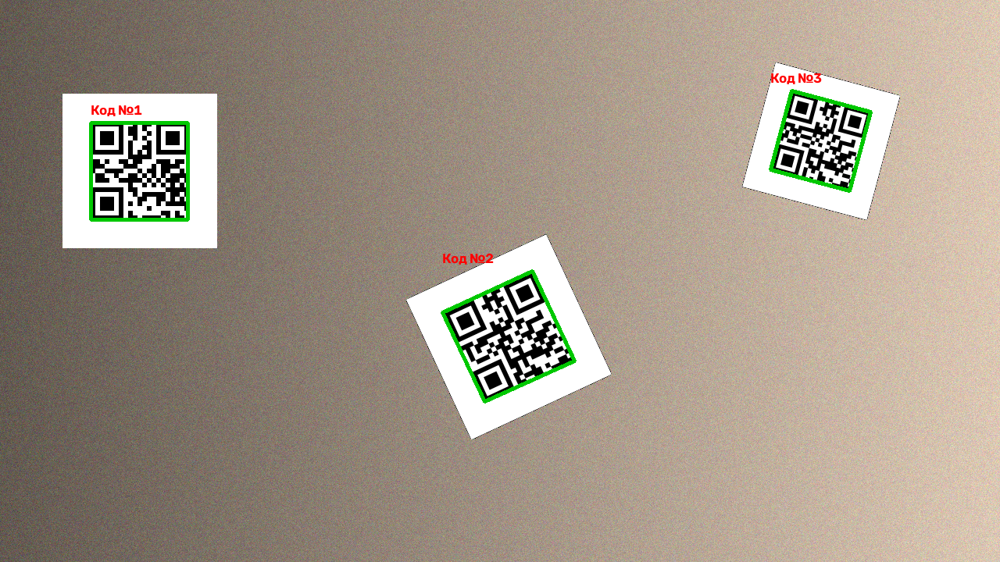

# QR Scanner (OpenCV)

Поиск и распознавание QR-кодов на изображениях и с веб-камеры.
Умеет находить несколько кодов в кадре, повёрнутые и наклонённые коды,
а также разбирает платёжные QR (формат ГОСТ Р 56042-2014, `ST00012|...`),
которые генерирует моё приложение mini-bank-app (соседний репозиторий).



## Как это работает

Распознавание построено как **каскад детекторов**: сначала дешёвые проверки,
дорогие — только для тех областей, где код ещё не прочитан.

```
кадр ──► 1. cv2.QRCodeDetector по всему кадру ──► нашёл все коды? ──► готово
                     │
                     ▼
         2. поиск кандидатов:
              • Haar/LBP-каскад (cv2.CascadeClassifier), если передан .xml
              • поиск «глазков» QR по иерархии контуров (без обучения)
                     │
                     ▼
         3. для каждой области: raw ► CLAHE ► бинаризация Оцу ► увеличение
```

**Поиск «глазков» (finder patterns).** У каждого QR-кода в трёх углах есть
квадраты «квадрат в квадрате в квадрате». Я бинаризую кадр адаптивным
порогом, строю дерево контуров (`cv2.RETR_TREE`) и оставляю квадратные
контуры с глубиной вложенности ≥ 2. Затем перебираю тройки и оставляю те,
что образуют прямоугольный равнобедренный треугольник (проверка по теореме
Пифагора). Четвёртый угол кода достраивается как `D = B + C − A`.

## Результаты

60 синтетических сцен (104 кода): случайный поворот 0–90°, перспектива,
размытие, до 3 кодов в кадре (`python tools/benchmark.py`):

| Метод                    | Распознано    | Время на кадр 1280×720 |
|--------------------------|---------------|------------------------|
| `cv2.QRCodeDetector`     | 62/104 (60%)  | ~57 мс                 |
| `QRScanner` (каскад)     | 103/104 (99%) | ~350 мс                |

Каскад заметно точнее, но медленнее — см. «Что можно улучшить».

## Установка и запуск

```bash
python -m venv .venv
source .venv/bin/activate          # Windows: .venv\Scripts\activate
pip install -r requirements.txt

python tools/generate_samples.py   # сгенерировать картинки в samples/
python main.py --image samples/multiple.png --save result.png
python main.py --image samples/payment.png
python main.py --camera 0          # веб-камера, выход — q
```

Пример вывода для платёжного кода:

```
Найдено кодов: 1 (21 мс)
[full-frame] ST00012|Name=Иван Иванов|PersonalAcc=40817810000000000001|...
  Платёжный QR:
    Получатель: Иван Иванов
    Счёт:       40817810000000000001
    Банк:       Мини Банк (БИК 044525000)
    Сумма:      1 500.00 ₽
```

## Тесты

```bash
pytest -q
```

Проверяются: повороты 0–90°, перспектива с размытием, несколько кодов,
кириллица, пустой кадр, разбор платёжной строки.

## Обучение своего Haar-каскада (необязательно)

Сканер работает и без него, но можно обучить классический каскад Виолы–Джонса:

```bash
python tools/prepare_cascade_data.py --pos 1000 --neg 2000

cd cascade_data
opencv_createsamples -info positives.txt -num 1000 -w 24 -h 24 -vec pos.vec
opencv_traincascade -data ../cascades -vec pos.vec -bg negatives.txt \
    -numPos 900 -numNeg 2000 -numStages 15 -w 24 -h 24 -featureType LBP
cd ..

python main.py --camera 0 --cascade cascades/cascade.xml
```

> Утилиты `opencv_createsamples` / `opencv_traincascade` не входят в пакет
> `opencv-python` и в свежих версиях OpenCV не собираются — их проще взять
> из сборки OpenCV 3.4.x.

## Структура

```
qr_scanner/
  detector.py   — каскад: QRCodeDetector + поиск глазков + Haar + предобработка
  payment.py    — разбор платёжных QR (ST00012)
main.py         — CLI: картинка или камера
tools/
  generate_samples.py     — синтетические тестовые картинки
  prepare_cascade_data.py — датасет для обучения Haar/LBP-каскада
  benchmark.py            — сравнение с базовым детектором
tests/          — pytest
```

## Что можно улучшить

- Скорость: для видео уменьшать кадр перед поиском глазков и запускать
  тяжёлые этапы не на каждом кадре, а, например, раз в 5 кадров.
- Отслеживание найденных кодов между кадрами (трекер), чтобы не искать заново.
- Проверить на реальных фотографиях, а не только на синтетике.
- Попробовать детектор на нейросети (`cv2.wechat_qrcode` из opencv-contrib).

## Стек

Python 3.10+, OpenCV, NumPy, pytest.
